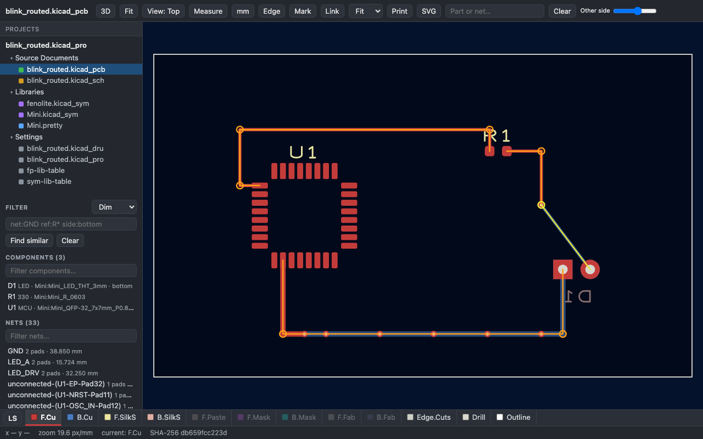

# Fenolite 0.5 — PCB automation in Python

Fenolite 0.5 brings a browser viewer and review tools to a Python library and CLI for PCB automation.
Create designs from code, inspect existing KiCad and Altium projects, and compare or convert designs
with a report of what changed.



## Highlights

- **Review in the browser.** Open supported boards, schematics, symbols, footprints and Altium Draftsman
  drawings. Explore layers, highlight nets, measure geometry and navigate project documents. Export a
  standalone HTML page for review. The viewer does not require KiCad or Altium to be installed.
- **Create from Python.** Define components, connections, placement, copper and rules. Generate PCB and
  schematic files, keep board edits through rebuilds and sync placements back to source.
- **Convert and compare.** Convert KiCad/Altium projects and downgrade KiCad 10 files for KiCad 9, with
  kept/changed/lost reports and source/readback comparisons. Conversion remains experimental.
- **More board workflows.** Board slots and cut-outs, copper-to-edge checks, panel generation and
  additional review tools. Support varies by backend and construct.
- **Work with agents.** Structured JSON, previewable writes, evidence labels and a packaged guide with
  board-design practice pages.

## Try it

Requires Python 3.11+:

```bash
python -m pip install fenolite==0.5.0
fenolite init blink --confirm --json
fenolite build blink/design.py --out blink/build --confirm --json
fenolite view blink/build --serve
```

The starter uses built-in components and needs no external CAD library. Use a new folder.
[The quickstart](../quickstart.md) explains expected outputs, reviewed plans and optional routing/checks.

## Scope

Altium writing and all conversion directions are experimental. Review the loss report and output before
using a conversion. Native Draftsman writing and Embedded Board Arrays remain gated in this release.
KiCad ERC, DRC, zone fills and fabrication export require `kicad-cli` 9 or 10; external routers have their
own prerequisites. An example or a passed software check does not establish electrical or manufacturing
suitability.

[Detailed release record](../release/v0.5.md) · [Changelog](../../CHANGELOG.md) ·
[PyPI](https://pypi.org/project/fenolite/0.5.0/) · [Documentation](../index.md)

## Feedback

Try the starter or a design you can discuss publicly. Tell us what worked, what was confusing and what
failed in [GitHub Issues](https://github.com/lgili/Fenolite/issues). Include the version, command and
error output with private content removed.
