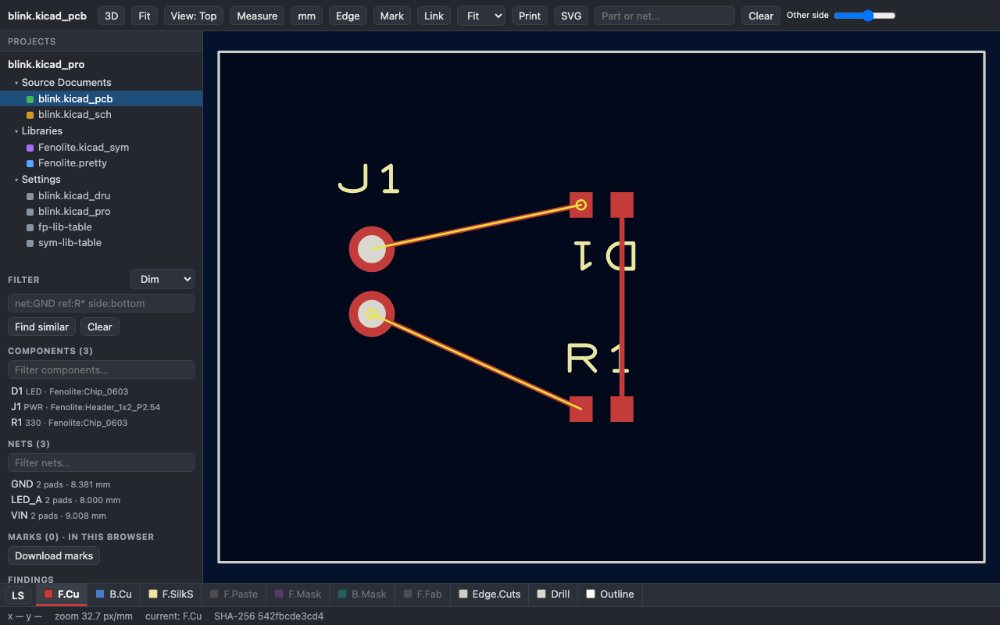

# Your first board with Fenolite

In this tutorial you will create an LED starter, build its PCB and schematic, and review them in a browser.
You need **Python 3.11+** and a browser. KiCad, Altium and external component libraries are not needed for
these first steps. Use a fresh working folder so existing files are not overwritten.

## 1. Install

```bash
python -m pip install fenolite
fenolite --version
fenolite capabilities --brief --json
```

The release used for this tutorial is **0.6.0**. To reproduce that exact release, install
`fenolite==0.6.0`. `capabilities` reports optional tools available on your machine.

## 2. Create and build

```bash
fenolite init blink --confirm --json
fenolite build blink/design.py --out blink/build --confirm --json
```

`blink/design.py` is your source: a two-pin header, resistor and LED, with placement on a 30 × 20 mm board.
Symbols and footprints come from Fenolite's built-in catalog. The build writes a KiCad project, PCB,
schematic and local libraries under `blink/build`. It does not run KiCad's electrical or physical checks.

The starter is an educational circuit, not a certified design. Review supply voltage, LED current and
ratings, footprints and manufacturing rules for your application.

## 3. Open it

```bash
fenolite view blink/build --serve
```

Open the local address printed by the command. Select a board or schematic from the project tree.
Use the wheel to zoom, drag to pan, click a pad to highlight its net, and press `F` to fit the view.
The server stays in the terminal; stop it with `Ctrl+C`.

You can also open your own supported files:

```bash
fenolite view board.kicad_pcb --serve
fenolite view Project.PrjPcb --serve
```

These are example filenames: replace them with a file you own. Read the [viewer guide](viewer.md)
for supported items, 3D models, measurement and rendering limits.

## 4. Keep a standalone review page

In a second terminal, or after stopping the server:

```bash
fenolite view blink/build --export blink/review.html --confirm --json
```

Open `blink/review.html` in your browser or hand it to a reviewer. The exported page embeds the viewable
documents; it needs no running Fenolite server. Review its contents before sharing a private design.

## Review a write before confirming

The short commands above use explicit `--confirm`. For reviewable automation, preview first:

```bash
fenolite view blink/build --export blink/review-planned.html --dry-run --json
```

Inspect `result.plan`, copy `result.plan_id`, then confirm that exact plan:

```bash
fenolite view blink/build --export blink/review-planned.html --confirm --plan PLAN_ID --json
```

Replace `PLAN_ID` with the returned value. If an input or target changes, Fenolite refuses the old plan;
preview again. Every command returns an exit code, a JSON result, issues and an evidence level.
See the [CLI contract](cli-contract.md).

## Optional: add demonstration copper

The starter's placement supports three straight connections. The built-in `direct` router can draw them
without an external router:

```bash
fenolite route blink/build --router direct --confirm --json
fenolite view blink/build --export blink/routed.html --confirm --json
```

This router draws straight tracks and performs no engineering routing checks. For production work, use a
supported external router or [copper intents in Python](copper.md), then check and review the board.
The screenshot below shows the starter after this routing step.



## Optional: KiCad checks and fabrication

Install KiCad **9 or 10**, with `kicad-cli` available on your command path, then rerun `capabilities`.
For the starter after routing:

```bash
fenolite fill blink/build --confirm --json
fenolite check blink/build --json
fenolite export blink/build -o blink/fab --all --manifest --confirm --json
```

Read the check report and resolve its findings before fabrication. A successful check is not a substitute
for engineering review. [Exports](exports.md) explains the available deliverables.

## Other optional tools

| Need | Install or configure |
|---|---|
| Polygon unions and other supported geometry operations | `python -m pip install 'fenolite[geo]'` |
| Freerouting integration | `fenolite fetch freerouting --help`; the router also needs Java |
| KiCadRoutingTools integration | External tool; see `fenolite capabilities --json` and the agent guide |
| Live KiCad IPC integration | `python -m pip install 'fenolite[kicad-ipc]'` |
| Meshed embedded 3D models | `gmsh` as a separate executable; without it the viewer falls back to extruded bodies |

Since 0.6 the package includes the stdlib-only MCP server (`fenolite mcp`) with script editing and image
replies; it needs no extra (the 0.5 `mcp` extra, an optional SDK only, is removed). See [MCP](mcp.md) and use
the documentation of the installed version.

## Next

- [Python DSL](dsl.md): change the starter and rebuild.
- [Viewer](viewer.md): layers, nets, schematics and review tools.
- [Conversion](conversion.md): experimental KiCad/Altium conversion and KiCad downgrade.
- [Agent guide](../src/fenolite/agent/skill/SKILL.md): `fenolite guide start --text`.
- [Help](https://github.com/lgili/Fenolite/issues): include version, command and error, with private details removed.
